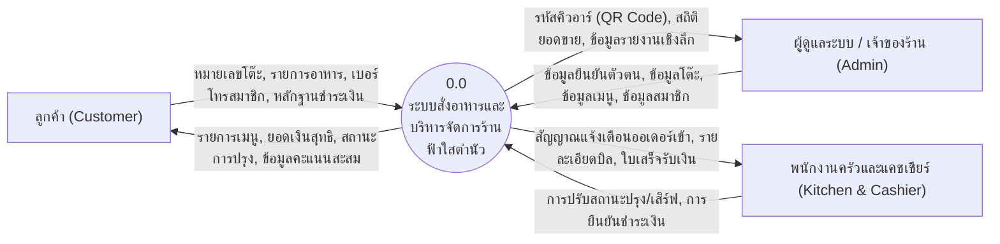
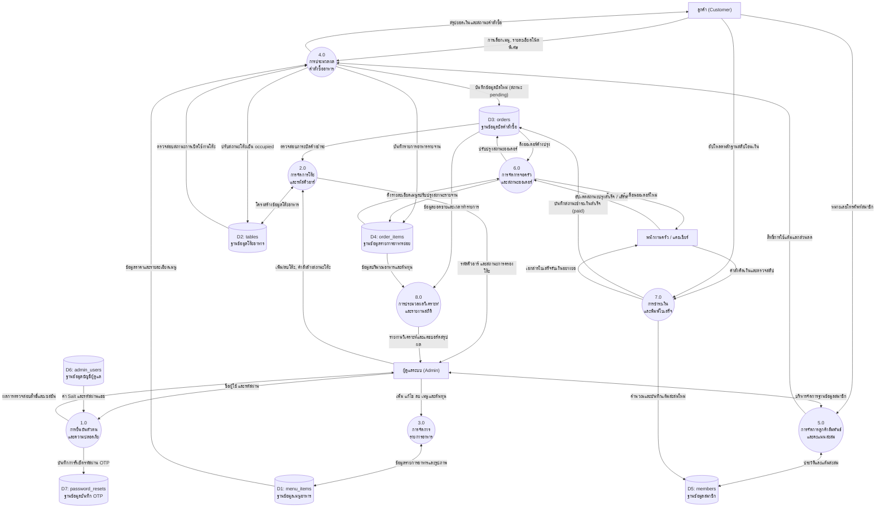
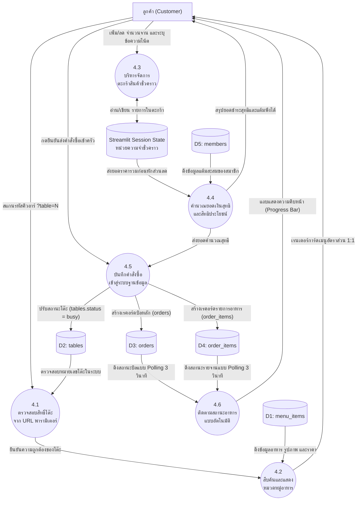
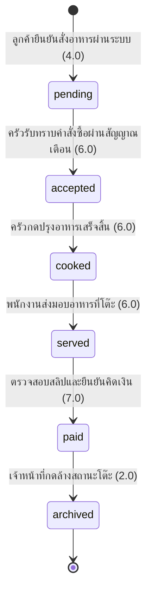

# เอกสารคู่มือระบบสารสนเทศร้านอาหารและสั่งอาหารอัจฉริยะ "ฟ้าใสตำนัว"
### (Fahsai Tum Nua - Restaurant Management System & Smart POS)

ระบบสารสนเทศเพื่อการบริหารจัดการร้านอาหารแบบบูรณาการ พัฒนาขึ้นด้วยภาษา **Python** และเฟรมเวิร์ก **Streamlit** บนสถาปัตยกรรมเว็บเชิงปฏิกิริยา (Reactive Web Architecture) ร่วมกับระบบจัดการฐานข้อมูลเชิงสัมพันธ์ **SQLite** ออกแบบเพื่อรองรับการสั่งอาหารผ่านรหัสคิวอาร์ประจำโต๊ะ (QR Code Table Ordering System) ควบคู่กับระบบแสดงผลในครัวและแคชเชียร์คิดเงิน (Kitchen Display System: KDS & POS) ระบบลูกค้าสัมพันธ์และการสะสมคะแนน (CRM & Loyalty Points) และการวิเคราะห์รายงานสถิติยอดขายเชิงลึก

---

## สารบัญ (Table of Contents)

1. [แผนภาพกระแสข้อมูลและสถาปัตยกรรมเชิงตรรกะ (Data Flow Diagram: DFD)](#1-แผนภาพกระแสข้อมูลและสถาปัตยกรรมเชิงตรรกะ-data-flow-diagram-dfd)
   - [1.1 สัญลักษณ์มาตรฐาน (Gane and Sarson Notation)](#11-สัญลักษณ์มาตรฐาน-gane-and-sarson-notation)
   - [1.2 แผนภาพบริบท (Context Diagram / DFD Level 0)](#12-แผนภาพบริบท-context-diagram--dfd-level-0)
   - [1.3 แผนภาพกระแสข้อมูลระดับที่ 1 (DFD Level 1)](#13-แผนภาพกระแสข้อมูลระดับที่-1-dfd-level-1)
   - [1.4 แผนภาพกระแสข้อมูลระดับที่ 2: กระบวนการสั่งอาหาร (DFD Level 2)](#14-แผนภาพกระแสข้อมูลระดับที่-2-กระบวนการสั่งอาหาร-dfd-level-2)
   - [1.5 แผนภาพวงจรสถานะของคำสั่งซื้อ (Order State Transition Diagram)](#15-แผนภาพวงจรสถานะของคำสั่งซื้อ-order-state-transition-diagram)
   - [1.6 พจนานุกรมข้อมูล (Data Dictionary)](#16-พจนานุกรมข้อมูล-data-dictionary)
2. [คู่มือการติดตั้งและกำหนดค่าระบบ (Installation & Deployment Guide)](#2-คู่มือการติดตั้งและกำหนดค่าระบบ-installation--deployment-guide)
   - [2.1 ความต้องการพื้นฐานของระบบ (System Prerequisites)](#21-ความต้องการพื้นฐานของระบบ-system-prerequisites)
   - [2.2 ขั้นตอนการติดตั้งบนเครื่องแม่ข่าย (Step-by-step Installation)](#22-ขั้นตอนการติดตั้งบนเครื่องแม่ข่าย-step-by-step-installation)
   - [2.3 การกำหนดค่าความปลอดภัยและการนำขึ้นคลาวด์ (Cloud Deployment)](#23-การกำหนดค่าความปลอดภัยและการนำขึ้นคลาวด์-cloud-deployment)
3. [คู่มือการใช้งานสำหรับผู้ดูแลระบบและแคชเชียร์ (Administrator & POS Cashier Manual)](#3-คู่มือการใช้งานสำหรับผู้ดูแลระบบและแคชเชียร์-administrator--pos-cashier-manual)
   - [3.1 การยืนยันตัวตนและการรักษาความปลอดภัย (Authentication & Security)](#31-การยืนยันตัวตนและการรักษาความปลอดภัย-authentication--security)
   - [3.2 แถบควบคุมส่วนหัวเคาน์เตอร์ (Admin Counter Header Bar)](#32-แถบควบคุมส่วนหัวเคาน์เตอร์-admin-counter-header-bar)
   - [3.3 แท็บที่ 1: การจัดการโต๊ะอาหารและการสร้าง QR Code (Table Management)](#33-แท็บที่-1-การจัดการโต๊ะอาหารและการสร้าง-qr-code-table-management)
   - [3.4 แท็บที่ 2: จอแสดงผลในครัวและแคชเชียร์คิดเงิน (KDS & POS Cashier)](#34-แท็บที่-2-จอแสดงผลในครัวและแคชเชียร์คิดเงิน-kds--pos-cashier)
   - [3.5 แท็บที่ 3: ระบบรายงานและวิเคราะห์ยอดขาย (Sales Analytics)](#35-แท็บที่-3-ระบบรายงานและวิเคราะห์ยอดขาย-sales-analytics)
   - [3.6 แท็บที่ 4: การบริหารจัดการลูกค้าสัมพันธ์และแต้มสะสม (Customer CRM)](#36-แท็บที่-4-การบริหารจัดการลูกค้าสัมพันธ์และแต้มสะสม-customer-crm)
   - [3.7 แท็บที่ 5: การบริหารจัดการรายการอาหารและต้นทุน (Menu Management)](#37-แท็บที่-5-การบริหารจัดการรายการอาหารและต้นทุน-menu-management)
4. [คู่มือการใช้งานสำหรับลูกค้า (Customer Self-Ordering Manual)](#4-คู่มือการใช้งานสำหรับลูกค้า-customer-self-ordering-manual)
   - [4.1 การเข้าสู่ระบบด้วยรหัสคิวอาร์ (QR Code Access)](#41-การเข้าสู่ระบบด้วยรหัสคิวอาร์-qr-code-access)
   - [4.2 การสืบค้นเมนูและการแสดงผลภาพอาหารสัดส่วน 1:1 (Menu Browsing)](#42-การสืบค้นเมนูและการแสดงผลภาพอาหารสัดส่วน-11-menu-browsing)
   - [4.3 การระบุข้อความพิเศษและการจัดการตะกร้าสินค้า (Customization & Cart)](#43-การระบุข้อความพิเศษและการจัดการตะกร้าสินค้า-customization--cart)
   - [4.4 การใช้แต้มสะสมสมาชิกแลกส่วนลด (Loyalty Points Redemption)](#44-การใช้แต้มสะสมสมาชิกแลกส่วนลด-loyalty-points-redemption)
   - [4.5 การติดตามสถานะอาหารแบบเรียลไทม์ (Live Order Tracking)](#45-การติดตามสถานะอาหารแบบเรียลไทม์-live-order-tracking)
   - [4.6 การชำระเงินผ่าน QR PromptPay และการส่งหลักฐานโอนเงิน (Payment & Slip Upload)](#46-การชำระเงินผ่าน-qr-promptpay-และการส่งหลักฐานโอนเงิน-payment--slip-upload)
5. [โครงสร้างไดเรกทอรีของโครงการ (Directory Structure)](#5-โครงสร้างไดเรกทอรีของโครงการ-directory-structure)

---

## 1. แผนภาพกระแสข้อมูลและสถาปัตยกรรมเชิงตรรกะ (Data Flow Diagram: DFD)

### 1.1 สัญลักษณ์มาตรฐาน (Gane and Sarson Notation)

| สัญลักษณ์ | องค์ประกอบ | คำนิยามเชิงวิชาการ | ตัวอย่างในระบบ |
|---|---|---|---|
| กรอบสี่เหลี่ยม | External Entity | บุคคลหรือระบบภายนอกที่เป็นต้นกำเนิดหรือปลายทางของข้อมูล | ลูกค้า (Customer), ผู้ดูแลระบบ (Admin), พนักงานครัว/แคชเชียร์ |
| กรอบสี่เหลี่ยมขอบมน | Process | กระบวนการหรือฟังก์ชันในการประมวลผลและแปลงสภาพข้อมูล | 4.0 ประมวลผลคำสั่งซื้อ, 7.0 ชำระเงิน |
| ช่องเปิดสองด้าน | Data Store | แหล่งจัดเก็บข้อมูลสารสนเทศที่มีโครงสร้าง (ตารางในฐานข้อมูล SQLite) | D1: menu_items, D3: orders |
| เส้นลูกศรระบุทิศทาง | Data Flow | ทิศทางและข้อมูลสารสนเทศที่ส่งผ่านระหว่างกระบวนการ | รายการคำสั่งซื้อ, หลักฐานการโอนเงิน |

---

### 1.2 แผนภาพบริบท (Context Diagram / DFD Level 0)

แสดงขอบเขตสูงสุดของระบบ (System Boundary) ในลักษณะกระบวนการเดี่ยว และความสัมพันธ์กับหน่วยงานภายนอก



---

### 1.3 แผนภาพกระแสข้อมูลระดับที่ 1 (DFD Level 1)

การแจกแจงกระบวนการหลักออกเป็น 8 กระบวนการย่อย พร้อมความสัมพันธ์กับแหล่งจัดเก็บข้อมูล 7 แหล่ง



---

### 1.4 แผนภาพกระแสข้อมูลระดับที่ 2: กระบวนการสั่งอาหาร (DFD Level 2)



---

### 1.5 แผนภาพวงจรสถานะของคำสั่งซื้อ (Order State Transition Diagram)



---

### 1.6 พจนานุกรมข้อมูล (Data Dictionary)

| รหัส | ชื่อตาราง | แอตทริบิวต์ (Attributes) | หน้าที่และความสัมพันธ์เชิงระบบ |
|---|---|---|---|
| D1 | `menu_items` | `id` (PK), `name` (Unique), `category`, `price`, `cost`, `image`, `description` | จัดเก็บข้อมูลรายการอาหาร ราคากลาง ต้นทุน และพาธไฟล์ภาพ WebP |
| D2 | `tables` | `id` (PK), `table_number` (Unique), `name`, `status` | จัดเก็บผังโต๊ะอาหารและสถานะความพร้อมให้บริการ (available/busy) |
| D3 | `orders` | `id` (PK), `table_id` (FK), `status`, `subtotal`, `discount`, `total_price`, `points_used`, `points_earned`, `member_phone`, `slip_image`, `created_at` | จัดเก็บบิลคำสั่งซื้อหลัก ข้อมูลทางการเงิน และสถานะการชำระ |
| D4 | `order_items` | `id` (PK), `order_id` (FK), `item_name`, `price`, `cost`, `quantity`, `note`, `status` | จัดเก็บรายการอาหารย่อยในบิล ข้อความระบุพิเศษ และสถานะการปรุง |
| D5 | `members` | `id` (PK), `first_name`, `last_name`, `phone` (Unique), `points`, `created_at` | จัดเก็บฐานข้อมูลสมาชิกและคะแนนสะสมเชิงความสัมพันธ์ |
| D6 | `admin_users` | `id` (PK), `username` (Unique), `password_hash`, `salt`, `full_name`, `role`, `email`, `created_at` | จัดเก็บบัญชีผู้ดูแลระบบพร้อมการเข้ารหัสความปลอดภัย SHA-256 + Salt |
| D7 | `password_resets` | `id` (PK), `user_id` (FK), `email`, `otp_code`, `created_at`, `expires_at`, `is_used` | จัดเก็บรหัส OTP สำหรับกระบวนการกู้คืนรหัสผ่านผ่านจดหมายอิเล็กทรอนิกส์ |

---

## 2. คู่มือการติดตั้งและกำหนดค่าระบบ (Installation & Deployment Guide)

### 2.1 ความต้องการพื้นฐานของระบบ (System Prerequisites)

- **ระบบปฏิบัติการ:** Windows 10/11, Ubuntu 20.04 LTS หรือใหม่กว่า, macOS Monterey หรือใหม่กว่า
- **สภาพแวดล้อมภาษา:** Python 3.10.x ขึ้นไป (รองรับได้ถึง Python 3.13)
- **เว็บเบราว์เซอร์:** Google Chrome, Apple Safari, Microsoft Edge, Mozilla Firefox เวอร์ชันล่าสุด

---

### 2.2 ขั้นตอนการติดตั้งบนเครื่องแม่ข่าย (Step-by-step Installation)

1. **โคลนซอร์สโค้ดของโครงการ:**
   ```bash
   git clone https://github.com/your-username/tumnua1.git
   cd tumnua1
   ```

2. **สร้างสภาพแวดล้อมเสมือน (Virtual Environment):**
   ```bash
   # สำหรับระบบปฏิบัติการ Windows
   python -m venv venv
   venv\Scripts\activate

   # สำหรับระบบปฏิบัติการ Linux / macOS
   python3 -m venv venv
   source venv/bin/activate
   ```

3. **ติดตั้งแพ็กเกจที่จำเป็นจาก requirements.txt:**
   ```bash
   pip install --upgrade pip
   pip install -r requirements.txt
   ```
   *รายการแพ็กเกจหลัก: `streamlit>=1.45.0`, `pandas>=2.0.0`, `Pillow>=10.0.0`*

4. **การเตรียมฐานข้อมูลเริ่มต้น:**
   ระบบจะทำการตรวจสอบและสร้างฐานข้อมูล `restaurant.db` พร้อมโหลด 131 เมนูอาหารเริ่มต้นให้อัตโนมัติเมื่อเริ่มระบบ หรือสามารถสั่งรันตรงได้ผ่านคำสั่ง:
   ```bash
   python database.py
   ```

5. **การสั่งประมวลผลระบบ (Run Application):**
   ```bash
   streamlit run app.py --server.port=8501 --server.address=0.0.0.0
   ```
   - เข้าใช้งานผ่านเครื่องแม่ข่าย: `http://localhost:8501`
   - เข้าใช้งานผ่านเครือข่ายแลน (LAN): `http://<SERVER_IP>:8501`

---

### 2.3 การกำหนดค่าความปลอดภัยและการนำขึ้นคลาวด์ (Cloud Deployment)

- **บัญชีผู้ดูแลระบบเริ่มต้น (Default Administrator Account):**
  - ชื่อผู้ใช้ (Username): `admin` (รองรับการพิมพ์ไม่จำกัดตัวพิมพ์เล็ก-ใหญ่)
  - รหัสผ่านเริ่มต้น (Password): `adminfahsaitumnua@12`
  - เข้ารหัสด้วย SHA-256 ผสาน Salt ป้องกัน Rainbow Table
- **การนำขึ้นระบบ Streamlit Community Cloud:**
  - กำหนด Main file path เป็น `app.py`
  - URL สำหรับลูกค้าสั่งอาหาร: `https://<your-subdomain>.streamlit.app/?table=1`
  - URL สำหรับเคาน์เตอร์ผู้ดูแลระบบ: `https://<your-subdomain>.streamlit.app/?mode=admin`

---

## 3. คู่มือการใช้งานสำหรับผู้ดูแลระบบและแคชเชียร์ (Administrator & POS Cashier Manual)

### 3.1 การยืนยันตัวตนและการรักษาความปลอดภัย (Authentication & Security)
- เข้าใช้งานผ่าน URL ที่ลงท้ายด้วย `?mode=admin`
- กรอกชื่อผู้ใช้และรหัสผ่านเพื่อเข้าสู่ระบบ
- หากลืมรหัสผ่าน ให้คลิกปุ่ม **"ลืมรหัสผ่าน?"** เพื่อส่งรหัส OTP แบบใช้ครั้งเดียวไปยังอีเมลของผู้ดูแลระบบที่ลงทะเบียนไว้
- ผู้ดูแลระบบสามารถเปลี่ยนรหัสผ่านใหม่ได้ที่ป๊อปโอเวอร์ **"เปลี่ยนรหัสผ่าน"** บนแถบด้านบน

### 3.2 แถบควบคุมส่วนหัวเคาน์เตอร์ (Admin Counter Header Bar)
- **การแสดงผลวันและเวลา:** แสดงวัน เดือน ปี และเวลามาตรฐานประเทศไทย (UTC+7 Asia/Bangkok) อย่างแม่นยำ เช่น `วันเสาร์ที่ 17 ตุลาคม พ.ศ. 2569 เวลา 09:25 น.` (บนจอคอมพิวเตอร์) และแบบย่อบนสมาร์ตโฟน
- **ช่องค้นหาด่วน (Live Search):** รองรับการพิมพ์ค้นหาทั้งรหัสบิล, หมายเลขโต๊ะ, ชื่ออาหาร หรือเบอร์โทรสมาชิก โดยผลลัพธ์จะปรากฏทันทีพร้อมปุ่มปิดผลค้นหา
- **ตัวบ่งชี้สถานะร้าน:** แสดงจำนวนโต๊ะว่างแบบสด และปุ่มทดสอบเสียงกระดิ่งแจ้งเตือน

### 3.3 แท็บที่ 1: การจัดการโต๊ะอาหารและการสร้าง QR Code (Table Management)
- **การเพิ่มโต๊ะใหม่:** กำหนดหมายเลขโต๊ะและชื่อเรียกเฉพาะ ระบบจะลงทะเบียนเข้าฐานข้อมูลและสร้างภาพ QR Code ให้ทันที
- **การพิมพ์รหัสคิวอาร์:** บันทึกภาพหรือสั่งพิมพ์รหัส QR Code ประจำแต่ละโต๊ะเพื่อติดไว้ ณ โต๊ะอาหารจริง
- **การล้างสถานะโต๊ะ (เคลียร์โต๊ะ):** เมื่อลูกค้ารายเดิมชำระเงินเรียบร้อย ให้กดปุ่ม **"ล้างสถานะโต๊ะ"** เพื่อคืนสถานะโต๊ะเป็น `available` พร้อมรับลูกค้ารายใหม่

### 3.4 แท็บที่ 2: จอแสดงผลในครัวและแคชเชียร์คิดเงิน (KDS & POS Cashier)
- **การทำงานแบบเรียลไทม์:** หน้าจอทำการตรวจสอบออเดอร์ใหม่ทุก 3 วินาทีแบบ Fragment อัตโนมัติ พร้อมเสียงกระดิ่งแจ้งเตือน
- **การควบคุมสถานะอาหารรายจาน:** รองรับการปรับสถานะ: `รอปรุง (Pending)` ➔ `ปรุงเสร็จ (Cooked)` ➔ `เสิร์ฟแล้ว (Served)`
- **การคิดเงินและตรวจสอบหลักฐาน:** 
  - ตรวจสอบยอดรวม ค่าอาหาร ส่วนลดสมาชิก และยอดชำระสุทธิ
  - ตรวจสอบรูปภาพสลิปหลักฐานการโอนเงินที่ลูกค้าอัปโหลดเข้ามาผ่านระบบ
  - กดยืนยันการชำระเงินเพื่อบันทึกสถานะบิลเป็น `paid` และพิมพ์ใบเสร็จรับเงินความร้อน (Thermal Receipt) ขนาด 80 มม. หรือ 58 มม.

### 3.5 แท็บที่ 3: ระบบรายงานและวิเคราะห์ยอดขาย (Sales Analytics)
- แสดงยอดขายรวม ยอดขายสุทธิ ต้นทุนรวม และกำไรขั้นต้น
- แสดงกราฟและตาราง 10 อันดับเมนูขายดีประจำวันและตลอดกาล
- รองรับการดาวน์โหลดชุดข้อมูลประวัติการขายเป็นไฟล์ CSV

### 3.6 แท็บที่ 4: การบริหารจัดการลูกค้าสัมพันธ์และแต้มสะสม (Customer CRM)
- ค้นหาข้อมูลสมาชิกด้วยหมายเลขโทรศัพท์ 10 หลัก
- เกณฑ์การสะสมแต้ม: ทุก 100 บาท ได้รับ 1 คะแนน
- เกณฑ์การแลกส่วนลด: ทุก 10 คะแนน แลกรับส่วนลด 25 บาท
- ตรวจสอบประวัติความถี่ในการใช้บริการ และปรับเพิ่ม/ลดแต้มสะสมด้วยตนเอง

### 3.7 แท็บที่ 5: การบริหารจัดการรายการอาหารและต้นทุน (Menu Management)
- เพิ่มเมนูใหม่พร้อมระบุหมวดหมู่ ราคาขาย ต้นทุนวัตถุดิบ และรูปภาพอาหาร
- แก้ไขราคา ปรับปรุงคำอธิบาย หรือลบเมนูที่ไม่จำหน่ายออกจากระบบ

---

## 4. คู่มือการใช้งานสำหรับลูกค้า (Customer Self-Ordering Manual)

### 4.1 การเข้าสู่ระบบด้วยรหัสคิวอาร์ (QR Code Access)
- ลูกค้านั่งประจำโต๊ะอาหาร และใช้สมาร์ตโฟนสแกน QR Code ประจำโต๊ะ
- ระบบจะเปิดหน้าเมนูอาหารของโต๊ะนั้นขึ้นมาทันทีโดยไม่ต้องดาวน์โหลดแอปพลิเคชัน (เช่น `https://domain/?table=1`)

### 4.2 การสืบค้นเมนูและการแสดงผลภาพอาหารสัดส่วน 1:1 (Menu Browsing)
- เลือกดูเมนูตาม 10 หมวดหมู่หลัก (ตำนัว, ตำพรีเมียม, ยำแซ่บ, ลาบ/ก้อย/น้ำตก, ย่าง/ทอด, ต้มแซ่บ/แกงอีสาน, อาหารจานเดียว, ของหวาน, เครื่องเคียง, เครื่องดื่ม)
- ค้นหาเมนูอาหารผ่านช่องพิมพ์ค้นหาด่วน
- รูปภาพอาหารทุกเมนูได้รับการบีบอัดเป็นไฟล์ WebP ความเร็วสูง และล็อกสัดส่วนสี่เหลี่ยมจัตุรัส 1:1 คงที่บนทุกขนาดหน้าจอ

### 4.3 การระบุข้อความพิเศษและการจัดการตะกร้าสินค้า (Customization & Cart)
- สามารถระบุข้อความระบุพิเศษในแต่ละจาน เช่น *"เผ็ดน้อย"*, *"ไม่ใส่ชูรส"*, *"แยกน้ำยำ"*
- ปรับเพิ่มหรือลดจำนวนจานผ่านปุ่มเครื่องหมายบวกและลบ

### 4.4 การใช้แต้มสะสมสมาชิกแลกส่วนลด (Loyalty Points Redemption)
- กรอกหมายเลขโทรศัพท์ 10 หลักในกล่องสมาชิกเพื่อตรวจสอบคะแนนสะสม
- หากมีคะแนนสะสมเพียงพอ สามารถเลือกจำนวนแต้มเพื่อนำมาเป็นส่วนลดเงินสดของบิลปัจจุบันได้ทันที

### 4.5 การติดตามสถานะอาหารแบบเรียลไทม์ (Live Order Tracking)
- เมื่อกดยืนยันส่งออเดอร์ ข้อมูลจะถูกส่งตรงเข้าห้องครัวทันที
- หน้าจอจะแสดงแถบความคืบหน้า (Progress Bar) และอัปเดตอัตโนมัติทุก 3 วินาที:
  - `รอร้านรับออเดอร์ (25%)`
  - `ครัวกำลังปรุงอาหาร (45%)`
  - `ปรุงเสร็จ กำลังทยอยเสิร์ฟ (75%)`
  - `เสิร์ฟถึงโต๊ะครบแล้ว (100%)`

### 4.6 การชำระเงินผ่าน QR PromptPay และการส่งหลักฐานโอนเงิน (Payment & Slip Upload)
- ตรวจสอบยอดสุทธิ และสแกน QR Code พร้อมเพย์ของทางร้านเพื่อโอนเงิน
- แนบรูปถ่ายสลิปการโอนเงินผ่านระบบเพื่อให้แคชเชียร์ตรวจสอบและปิดบิล

---

## 5. โครงสร้างไดเรกทอรีของโครงการ (Directory Structure)

```text
restaurant_system/
├── app.py                      # ไฟล์หลักควบคุมการทำงานและการกำหนดเส้นทาง (Routing)
├── config.py                   # การกำหนดค่าระบบ, ธีม CSS, เวลาประเทศไทย UTC+7, ฟังก์ชันรูปภาพ
├── database.py                 # สคริปต์โครงสร้างฐานข้อมูล SQLite และชุดข้อมูลเริ่มต้น 131 เมนู
├── requirements.txt            # รายการไลบรารีและแพ็กเกจไพทอน
├── restaurant.db               # ไฟล์ฐานข้อมูลเชิงสัมพันธ์ SQLite
├── README.md                   # เอกสารคู่มือระบบสารสนเทศฉบับสมบูรณ์เชิงวิชาการ
├── static/
│   ├── favicon.ico             # ไอคอนประจำเว็บ
│   ├── img/
│   │   ├── logo.png            # โลโก้หลักของร้านฟ้าใสตำนัว
│   │   └── menu/               # โฟลเดอร์เก็บรูปภาพเมนูอาหาร WebP 1:1 (menu1.webp - menu131.webp)
│   └── sound/
│       └── bell.wav            # ไฟล์เสียงกระดิ่งแจ้งเตือนออเดอร์ใหม่
├── utils/
│   ├── audio.py                # โมดูลเล่นเสียงกระดิ่งแจ้งเตือน
│   ├── auth.py                 # ระบบยืนยันตัวตนและการแฮชรหัสผ่าน
│   ├── email_service.py        # บริการส่งอีเมลรหัส OTP กู้คืนรหัสผ่าน
│   └── receipt.py              # โมดูลเรนเดอร์ใบเสร็จรับเงินความร้อน
└── views/
    ├── customer_view.py        # หน้าจอสั่งอาหารและติดตามสถานะสำหรับลูกค้า
    └── admin/
        ├── __init__.py         # แดชบอร์ดและเมนู 5 แท็บหลักของผู้ดูแลระบบ
        ├── auth_view.py        # แถบหัวเคาน์เตอร์, ระบบค้นหาด่วน และการเข้าสู่ระบบ
        ├── kds_pos_view.py     # จอครัว KDS, แคชเชียร์ตรวจสลิป และคิดเงิน
        ├── member_view.py      # ทะเบียนประวัติลูกค้าและระบบสมาชิกสะสมแต้ม
        ├── menu_view.py        # การเพิ่ม แก้ไข ลบ เมนูอาหารและต้นทุน
        ├── report_view.py      # รายงานวิเคราะห์ยอดขายและกราฟสถิติ
        └── table_view.py       # การจัดการผังโต๊ะอาหารและการสร้าง QR Code
```
